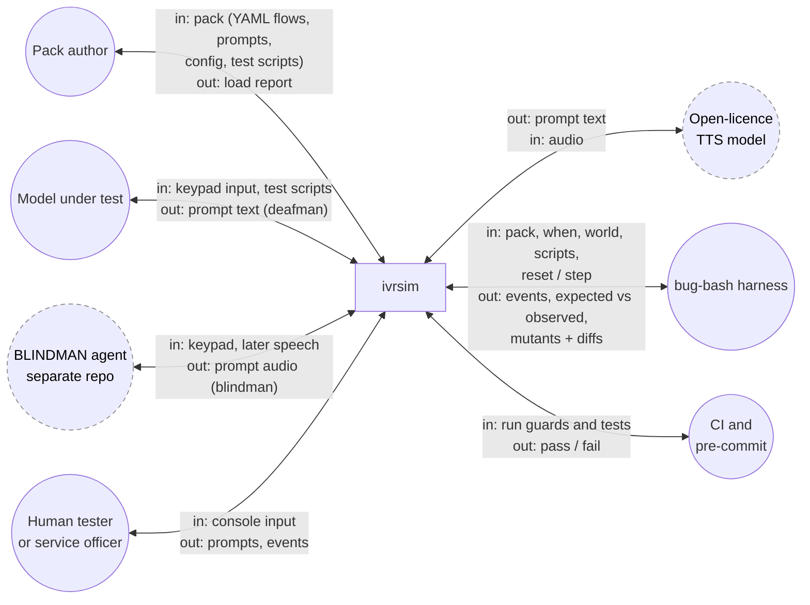
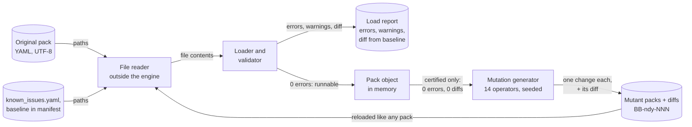
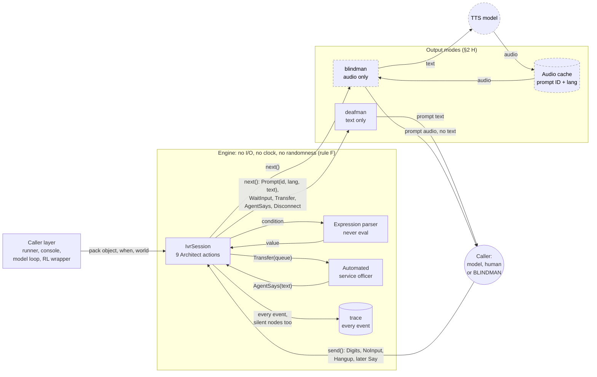
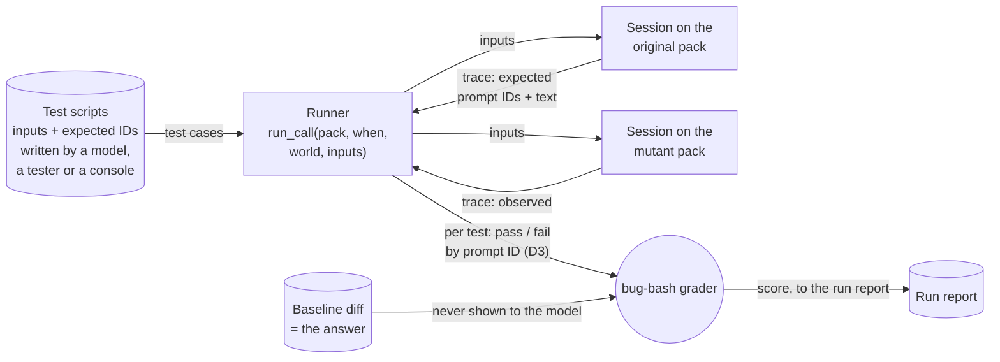

# ivrsim — design (release 1)

**Status: PROPOSAL, 2026-11-05.** `ivrsim` is the IVR simulator that bug-bash
uses as its system under test. Release 1 is an **LLM training and testing
tool**, built in public in this repository so the harness, and the tuning done
to improve it, can be seen commit by commit. This document is the design and a
dry run of it on paper, written before any code.

---

## 1. What it is

A **generic Genesys Cloud IVR simulator**. One engine knows how Genesys Cloud
Architect behaves, and data files say what one service does. The engine knows
Architect actions, flow types, expressions, prompts, schedules, queues and data
tables. It knows nothing about any particular organisation: every service,
menu, prompt and rule is in the data files.

**One data pack** is a folder holding one service's call flows, prompts,
configuration, agent scenarios and test scripts. The sample pack is entirely
fictitious (section 6).

**Releases and their audiences:**

| Release | Audience | What it adds |
| --- | --- | --- |
| **1.0** (this repository) | LLM training and evaluation | A fully automated engine: load a pack and a test deck, run the caller's test cases, answer as the IVR and as an automated service officer. Minimal developer consoles. YAML data files. Text only |
| 2 | IVR testers | Polished pages, pick lists and other human-support features, campaign calls, an Excel workbook importer and exporter, richer agent scenarios |
| 2.0 (optional) | Both | Text-to-speech and speech-to-text, for defects caused by poor conversion. This adds the `blindman` output mode (section 2, H) |

Release 1 is text only, which makes it the **`deafman` output mode** (section 2,
H). Release 2.0's speech output adds the **`blindman` mode**.

**Platform stages:** (1) everything on one dev PC; (2) the simulator and the
caller over a private LAN; (3) the same Python engine running in a browser
through Pyodide, with no install. Stage 3 is why the engine stays plain Python
(section 2, F).

---

## 2. Options, and the constraint that decides each

Three constraints drive the choices:
- **C1, the injector**: it reads a build, changes one thing and writes it back,
  mechanically.
- **C2, the model**: in white-box mode, a model reads the build inside a
  prompt.
- **C3, the grader**: every call is deterministic and fast, thousands per run.

### A. Call-flow format: a minimal node graph of our own

| Option | For | Against |
| --- | --- | --- |
| A1. Archy-style YAML (Genesys's own text format) | Closest to the platform | Verbose and nested: single-point mutation is awkward (C1), and it costs tokens (C2) |
| **A2. A minimal node graph**: `nodes: {id: {action, …, next/branches}}` | One node per key, so a mutation is one key change (C1); short and readable (C2) | Not Genesys's own syntax |
| A3. Architect JSON export | Real artifacts | Real exports are other people's configuration, so they can't be published |

**Chosen: A2.** Action names and their outputs follow Architect (`menu`,
`collect_input`, `evaluate_schedule_group` with outputs `open`, `closed`,
`holiday`, `emergency`, and so on). Archy and Architect JSON can arrive later as
importers into A2.

### B. Serialisation: YAML for everything

**Chosen: YAML (PyYAML), UTF-8, for flows, prompts, configuration and test
scripts.** It favours full automation. A CSV or Excel view comes back in
release 2, as one sheet of a workbook.

### C. Expressions: a small Architect subset, never `eval`

**Chosen: our own tokenizer and recursive-descent parser for a small subset of
the Architect expression language.** It has:
- comparisons (`==`, `!=`, `<`, `>`, `<=`, `>=`), `And`, `Or` and `Not`;
- string and integer literals, and `Flow.` and `Participant.` variables;
- the functions `IsSet`, `IsNotSetOrEmpty`, `ToInt`, `ToUpper` and `Trim`.
  `ToUpper` and `Trim` let a flow normalise a string before comparing it,
  the defensive habit that the exact comparison below makes necessary.

An unknown function is a load-time error, never a runtime guess.

**String comparison is exact** (decided 2026-11-11): case-sensitive, with no
trimming of white space and no removal of invisible characters. Data crosses
case-sensitive subsystems and databases on real platforms, so the simulator
never forgives a mismatch that a later system would not. The
`inconsistent_naming` operator (`ivrsim/CATALOGUE.yaml`) depends on this.

### D. What the caller observes: ID, language and text

| Option | Black-box realism | Grading | Kills a prompt-text mutant? |
| --- | --- | --- | --- |
| D1. Prompt IDs only | No | Stable | **No** |
| D2. Text only | Yes | Brittle | Yes |
| **D3. Each `Prompt` carries `id`, `lang` and `text`. Tests assert by ID, and the runner compares the text heard with the ORIGINAL pack's text for that ID** | The model hears text only in black-box mode | Stable | **Yes** |

**Chosen: D3.** It avoids the circular test: expectations come from the
original pack, and the run uses the mutant.

### E. Where it lives

A self-contained top-level `ivrsim/` package in this repository, which never
imports `bugbash`. A test enforces that, so the package can be split out later.

### F. Determinism and portability

**No wall clock, no randomness, no threads, no sockets, no subprocesses inside
the engine.** A session takes an explicit `when` (an aware datetime) and a
`world` (emergency flags, agents available, wait-time overrides). The loader
takes file *contents*, not paths. Callers (the runner, the consoles, a server
or a browser page) do all the input and output, which is what lets the same
engine run in Pyodide.

### G. The AI-facing surface

| Use | What it calls |
| --- | --- |
| Bug-finding evaluation | The model writes test scripts (data); the grader runs them against the original and the mutant |
| Model as the caller | `next()`/`send()` in a loop; the model hears prompt text only (`deafman` mode) |
| Agent as an audio caller (release 2.0) | The same loop in `blindman` mode: the agent receives prompt audio only |
| RL-style environment | A thin `reset(pack, when, world)` / `step(action)` wrapper; rewards stay in bug-bash, not in the engine |
| Synthetic transcripts | Enumerate paths; the event streams become transcripts, fictitious by construction |

### H. Output modes: `deafman` and `blindman`

The same call flow can be delivered through **one sense only**. A mode is a
presentation layer over `next()`. The engine, the pack, `send()` and `trace`
are identical in every mode.

| Mode | The caller receives | Serves | Agent under test |
| --- | --- | --- | --- |
| **`deafman`** (release 1) | Prompt text only, never audio | Callers who are deaf or hard of hearing, as text relay and real-time text (RTT) serve them | A language model reading text |
| **`blindman`** (release 2.0) | Prompt audio only, never text | Callers who are blind or have low vision | An agent that must recognize the prompt by ear, such as [BLINDMAN](https://github.com/davidyoung8196504567-sudo/blindman) |

- **`deafman`** passes `Prompt.text` through. It is what release 1 already
  does, given a name.
- **`blindman`** renders each `Prompt` to audio with an open-licence
  text-to-speech model, and later optionally with recorded prompts. It
  withholds `text`. Rendering happens **outside the engine**, in the caller
  layer, so the engine keeps rule F: no I/O, no randomness, and it still runs
  under Pyodide. Audio is cached by prompt ID and language, so a run stays
  deterministic.
- **Input is unchanged:** keypad digits in both modes, plus `Say(text)` once
  speech input exists.
- **Grading is unchanged:** the runner grades on `trace` and prompt IDs
  (option D3), never on what the caller heard. A mode cannot change a score
  through grading, only through the caller's behaviour.

**Why both:** running one pack in both modes measures what hearing adds or
costs. A prompt that reads clearly but is misheard when spoken (a homophone,
or a number read too fast) is a defect only `blindman` exposes. A model that
passes in `deafman` and fails in `blindman` has found a speech-specific defect
or has a weak ear, and comparing the two traces tells which.

**Who owns what:** `ivrsim` owns both modes. BLINDMAN is a separate public
project that supplies the ear: a recognizer that turns `blindman` audio back
into something an agent can act on. It uses `ivrsim` as a dependency and never
copies it, so section 6's guards still cover every pack.

### The session interface

```python
session = IvrSession(pack, when=datetime(...), world={...})
session.next()   # -> Prompt(id, lang, text) | WaitInput(kind, min, max, terminator)
                 #    | Transfer(queue) | AgentSays(text) | Disconnect(reason)
session.send(e)  # e: Digits("1") | Digits("000101#") | NoInput() | Hangup() | Say(text)
session.trace    # the full event stream, including silent nodes
run_call(pack, when, world, inputs) -> list[Event]
```

`next()` returns only what the caller perceives. `trace` holds everything,
including nodes the caller never hears. Black-box mode sees `next()`; white-box
mode and debugging see `trace`.

### Functional components and I/O

**Status: proposed, for review.** Every arrow is labelled with what passes
along it.

**Legend:**
- **Circles** are outside `ivrsim`.
- **Cylinders** are data files.
- **Dashed borders** mark release 2.0 parts.

There are four views:
1. context: `ivrsim` and everything outside it;
2. loading and mutation;
3. one call;
4. testing and grading.

**1. Context: `ivrsim` as one box**



**2. Loading and mutation**



**3. One call: the session and the output modes**



**4. Testing and grading**



**Notes on the diagram:**
- **The engine takes file contents, not paths (rule F).** A thin reader
  outside the engine does the file I/O. The same engine can then run under
  Pyodide, where a browser page supplies the contents.
- **`when` and `world` are inputs to every session.** The clock and the state
  of the world (emergency flags, agents available, wait times) come in from
  outside, which keeps every run repeatable.
- **The two output modes sit between `next()` and the caller.** `send()` and
  `trace` bypass them, so grading never depends on the mode.
- **Open question: where the runner ends and the grader begins.** §2 E says
  `ivrsim` never imports `bugbash`, and §2 G says rewards stay in bug-bash.
  The diagram therefore puts the runner, which produces expected and observed
  events, in `ivrsim`, and the scoring in bug-bash. §7 lists "Runner and
  grader" as one step, so this split needs a decision.

---

## 3. The dry run on paper

### The pack (cut to what proves the loop)

`flows/main.yaml`:

```yaml
flow: main
type: inbound_call
start: lang_menu
nodes:
  lang_menu:
    action: menu
    prompt: P_LANG
    options: {"1": set_en, "2": set_fr}
    no_input: {retries: 2, then: bye_fail}
    no_match: {retries: 2, then: bye_fail}
  set_en: {action: set_language, language: en, next: hours}
  set_fr: {action: set_language, language: fr, next: hours}
  hours:
    action: evaluate_schedule_group
    group: NDY_Hours
    open: main_menu
    closed: closed_msg
    holiday: holiday_msg
    emergency: emergency_msg
  closed_msg:    {action: play_audio, prompt: P_CLOSED,    next: bye}
  holiday_msg:   {action: play_audio, prompt: P_HOLIDAY,   next: bye}
  emergency_msg: {action: play_audio, prompt: P_EMERGENCY, next: bye}
  main_menu:
    action: menu
    prompt: P_MAIN
    options: {"1": ask_id, "2": to_general}
    no_input: {retries: 2, then: to_general}
    no_match: {retries: 2, then: bye_fail}
  ask_id:
    action: collect_input
    prompt: P_ENTER_ID
    digits: {min: 6, max: 6, terminator: "#"}
    into: Flow.ClientId
    success: lookup
    failure: to_general
  lookup:
    action: data_table_lookup
    table: Clients
    key: Flow.ClientId
    outputs: {tier: Flow.Tier}
    found: route
    not_found: to_general
  route:
    action: decision
    expression: 'Flow.Tier == "priority"'
    "yes": to_priority
    "no": to_general
  to_priority: {action: transfer_to_acd, queue: Priority_Claims,   prompt: P_XFER}
  to_general:  {action: transfer_to_acd, queue: General_Enquiries, prompt: P_XFER}
  bye:      {action: disconnect}
  bye_fail: {action: play_audio, prompt: P_GOODBYE, next: bye}
```

`prompts.yaml`:

```yaml
P_MAIN:
  en: "For your pension payment, press 1. For anything else, press 2."
  fr: "Pour votre paiement de pension, faites le 1. Pour toute autre question, faites le 2."
```

`config/schedules.yaml`:

```yaml
NDY_Hours:
  time_zone: America/Toronto
  open: {mon-fri: "08:30-16:30"}
  holidays: ["2026-12-25", "2026-12-26"]
  emergency: off   # the world state can switch it on
```

The configuration also names two queues, `General_Enquiries` and
`Priority_Claims`. The `Clients` table has keys `000101` (tier `priority`) and
`000202` (tier `standard`).

### One call, traced by hand

The call is on Wednesday 2026-11-04 at 10:00 America/Toronto. The caller
presses 1, then 1, then enters 000101#.

| # | `next()` returns | Caller `send()`s | In `trace` only |
| --- | --- | --- | --- |
| 1 | `Prompt(P_LANG, en, …)` | | node `lang_menu` |
| 2 | `WaitInput(dtmf, max=1)` | `Digits("1")` | `set_en`, language en |
| 3 | | | `hours`: NDY_Hours → **open** |
| 4 | `Prompt(P_MAIN, en, …)` | | |
| 5 | `WaitInput(dtmf, max=1)` | `Digits("1")` | |
| 6 | `Prompt(P_ENTER_ID, en, …)` | | |
| 7 | `WaitInput(dtmf, 6, 6, "#")` | `Digits("000101#")` | Flow.ClientId = "000101" |
| 8 | | | `lookup` found; Flow.Tier = "priority" |
| 9 | | | `route` → true |
| 10 | `Prompt(P_XFER, en, …)` | | |
| 11 | `Transfer(Priority_Claims)` | | the IVR leg ends; the agent leg begins |

The test script (data, not code):

```yaml
case: NDY_001
when: "2026-11-04T10:00 America/Toronto"
world: {emergency: off}
steps:
  - expect_prompt: P_LANG
  - press: "1"
  - expect_prompt: P_MAIN
  - press: "1"
  - expect_prompt: P_ENTER_ID
  - press: "000101#"
  - expect_prompt: P_XFER
  - expect_transfer: Priority_Claims
```

### What the trace exposed

| # | Finding | Resolution |
| --- | --- | --- |
| F1 | **Barge-in.** On Genesys, a key pressed during a prompt interrupts it | ASSUMPTION A1: keys are applied at the next `WaitInput`, and prompts are heard in full |
| F2 | **Silent nodes** (steps 3, 8 and 9) produce nothing for the caller | `next()` returns only what is perceived; `trace` holds everything |
| F3 | **ID versus text.** With ID-only assertions, a swapped French text survives | Option D3 |
| F4 | **A missing language row** | The loader rejects it by default; a pack may opt into a fall-back (ASSUMPTION A2) |
| F5 | **Leading zeros.** `000101` read as an integer becomes 101 | Keys and collected digits are always strings |
| F6 | **One digit or many?** | One `send` per `WaitInput`; inter-digit timeouts are not modelled (ASSUMPTION A3) |
| F7 | **Schedule precedence** on a holiday that falls in business hours | Emergency beats holiday, and holiday beats open or closed (ASSUMPTION A4, to be checked against Genesys's documentation) |
| F8 | **Is a transfer the end?** | It ends the IVR leg. An agent leg follows: `AgentAlerted`, `AgentAnswered`, `AgentSays`, `WrapUp`, `Disconnect`. Release 1 has no in-queue treatment |
| F9 | **"2 retries"**: 2 hearings or 3? | ASSUMPTION A5: re-tries, so 3 hearings. It is also a mutation operator |

Every ASSUMPTION goes in one published list, so users know where the simulator
may differ from the platform.

### One mutation, three tests

Mutant M1 (`menu_key_swap`): in `main_menu`, key 1 goes to `to_general` and key
2 to `ask_id`.

| Test | On M1 | Verdict |
| --- | --- | --- |
| NDY_001 | the caller hears P_XFER where P_ENTER_ID was expected | **killed** |
| NDY_002 (Saturday) | never reaches the main menu | survives; not a gap, because NDY_001 kills it |
| NDY_003 (no input twice at the main menu) | `to_general` on both builds | survives |

**An equivalent mutant:** swapping the prompts on `to_priority` and
`to_general` changes nothing observable, because both play P_XFER. It is
recorded with that reason and never counted as a gap.

**The boundary case:** moving closing time from 16:30 to 16:00 is caught only by
a call between 16:00 and 16:29. A path-walker testing 10:00 and 20:00 misses
it; a model reading "open 8:30 to 4:30" can catch it. That is where model and
baseline should separate.

---

## 4. The mutation catalogue (release 1)

Each operator makes one change to one node or row.

| Operator | Change | Defect class |
| --- | --- | --- |
| `menu_key_swap` | swap two option keys' targets | menu wired against the flow diagram |
| `menu_option_drop` | remove one option | a missing option |
| `branch_swap` | swap a decision's `yes` and `no` | inverted condition |
| `compare_flip` | `==` ↔ `!=`, `<` ↔ `<=` | comparison or boundary error |
| `retry_off_by_one` | `retries` ±1 | retry count misconfigured |
| `wrong_queue` | transfer to another configured queue | routing error |
| `language_unset` | remove one `set_language` | language path not set |
| `prompt_swap` | two prompts swap text in one language | the wrong audio file loaded |
| `prompt_lang_swap` | swap one prompt's EN and FR text | the French recording on the English path |
| `schedule_shift` | an open or close time ±30 min | hours entered wrong |
| `holiday_drop` | remove one holiday | holiday calendar not updated |
| `table_cell_swap` | swap one column between two rows | data-table entry error |
| `collect_length` | `digits.max` ±1 | length validation wrong |
| `accent_corrupt` | one French prompt's accents damaged, `mojibake` (`é` → `é`) or `strip` (`é` → `e`), chosen by seed | encoding error; text exported without accents |

Architect does not check accents when it publishes, so the load report raises
no warning for `accent_corrupt`. Only a test that hears the French prompt
catches it.

### The load report and the baseline

**Every load writes a report**, with three levels:

| Level | Example | Can the loader see it? |
| --- | --- | --- |
| **Error** (Architect would refuse to publish) | a dangling `next`, a missing `fr` row, an unknown queue | Yes, and the pack does not run |
| **Warning** (publishes, but suspicious) | an unreachable node | Yes |
| **Semantic defect** (valid, but wrong) | every mutant above | Only against a **baseline** (a diff) or through tests |

- A pack's manifest may name its **baseline**. The report then lists every
  difference from it, so a defect already present, seeded or accidental, is
  documented.
- **A clean load is a certificate**: 0 errors, every warning acknowledged in
  `known_issues.yaml`, and 0 differences. It is what lets bug-bash serve the
  correct build for its "no bug exists" scenario. A model that reports a bug
  there is a false positive.

**The mutation generator is part of `ivrsim`**, because it needs the baseline:
- it refuses to run on an uncertified pack;
- every mutant loads with 0 errors and differs from the baseline by exactly one
  change;
- each mutant is stored with its diff, so its fix is the inverse diff, and
  "mutate, then fix" must give back the baseline;
- **the baseline diff is the answer**: it goes to the grader, never to the
  model.

---

## 5. Joke decoys and design smells

### The sample service: *Not Dead Yet Pension Line*

A fictitious bilingual pension service whose central business is confirming
that a client is still alive. A few literary jokes are hidden in the data
(Towel Day, 25 May, as a holiday; the goodbye prompt; a queue name).

### Joke decoys: the spec beats the joke

Wherever a famous joke suggests a value, the spec deliberately states a
different one, and the tests check the spec's. A model that pattern-completes
from the joke instead of reading the spec is wrong, and measurably so. Decoys
are listed in a hidden answer key, `decoys.yaml`. bug-bash can report a
**decoy-error rate**: how often a model expected the joke rather than the spec.

### Design smells: valid by the spec, poor by industry norms

Some IVRs confuse callers in ways their own spec requires: a "main menu" key
that doesn't return to the main menu in one place, and replays it when you're
already there. **A design smell is not a bug.** The baseline does what the
spec says, so a test that "catches" a smell fails on the baseline and scores
zero. A model that reports one as a bug is a false positive.

| Smell class | What it means (in general) |
| --- | --- |
| `main_menu_key_inconsistent` | the "main menu" key behaves differently in different places |
| `key_meaning_varies` | one key does different jobs in different menus |
| `key_before_option` | the key is said before the option, so the caller must hold it in mind |
| `too_many_options` | more options in a menu than a caller can hold |
| `no_repeat_option` | no way to hear a menu again |
| `no_agent_escape` | no route to a person from a menu |
| `asks_twice` | the same information is collected twice |
| `long_preamble` | too many messages before the first menu |
| `dead_end` | a branch that ends the call with no way back |

**Which smells the sample pack plants, and where, is not published.** That
list is the hidden answer key, `design_smells.yaml`. The examples in the
paragraph above illustrate the idea and are not taken from the pack.

**A bonus question (later):** *"Evaluate the IVR you tested, against the spec
and against industry norms."* The answer is structured, as a list of `{node,
smell class, one-line reason}`, so no judge is needed. It is scored three
ways: recall of the planted smells, precision, and whether each finding was
filed in the right bin (a bug against the spec, or a smell against the norms).

---

## 6. Keeping the repository clean

- **Every pack and every catalogue entry is fictitious.** None of it comes from
  any real organisation's flows, prompts or data.
- **Guards**, each proved to work by planting a violation:
  1. **engine-is-generic**: no organisation-specific vocabulary in `ivrsim/`;
  2. **pack-is-fictitious**: no telephone number outside the fictitious
     555-01xx range, and no 9-digit identifier shapes;
  3. **catalogue-is-generic**: guard 1 run over the catalogue;
  4. **`ivrsim` imports nothing from `bugbash`**;
  5. **no-invisible-characters**: no tab, carriage return, zero-width or
     no-break space, byte-order mark or other character a reader cannot see,
     in any file. A pack writes them as escapes, so a reviewer can see them.
- Guards 1 and 2 run as a **pre-commit hook** as well as in CI, because a
  public commit is permanent.

---

## 7. Build plan (bug-bash Phase 1, 2026-11-05 → 11-15)

| When | Step | Done when |
| --- | --- | --- |
| 11-05/06 | **Formats**: flow schema, `prompts.yaml`, `config/*.yaml`, test scripts; written up as `ivrsim/FORMATS.md` | The section 3 pack is written in them, complete |
| 11-06 | **Loader, validator and load report** | Each check has a broken pack it rejects; the baseline loads clean |
| 11-06/07 | **Session engine**: 9 actions, the expression subset, `next`/`send`/`trace`, `run_call`, the ASSUMPTION list | The section 3 trace is reproduced exactly as a pytest |
| 11-07 | **Guards 1–4**, and the pre-commit hook | Each guard proved to bite |
| 11-08 | **Not Dead Yet Pension Line**: the full bilingual pack, decoys, planted smells, and a readable spec rendered from the original build | Spec reviewed against the pack |
| 11-09/10 | **Mutation generator**: 14 operators, certified baseline only, IDs `BB-ndy-NNN`, diffs stored, cached | Every mutant hand-reviewed; equivalents recorded with the reason |
| 11-10 | **Runner and grader**: expected from the original, observed from the mutant | M1 killed; the equivalent mutant recorded |
| 11-10/11 | **Automated service officer**: answer, say, wrap up, end | One test covers a call from dial to wrap-up |
| 11-11 | **Developer consoles**: manual caller and manual service officer; reload after editing; record a hand-driven call as a test case | A recorded call replays with identical events |
| 11-11/12 | **Path-walker baseline** over the node graph | Scored per operator |
| 11-13/15 | Flows 2 and 3, CI | CI green on 3.12 and 3.14 |

**Environment:** `python -m venv .venv`, then `pip install -e ".[dev]"`, with
PyYAML and pytest pinned in `pyproject.toml`.

**Deferred:**
- in-queue treatment, wait-time announcements and callbacks;
- surveys and email;
- campaigns;
- polished pages and pick lists;
- the workbook importer;
- the Archy and Architect-JSON importers;
- text-to-speech and speech-to-text, and with them the `blindman` output mode
  (section 2, H);
- a model's proposed fixes as a scored task;
- the bonus evaluation question.
